<div align="center">

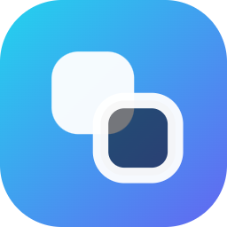

# SwapDeck

**Switch Steam accounts in one click, and launch every game with the right account, monitor, resolution and sound.**<br>
Built for people who keep separate FPS, sim racing and horror accounts. Your Minecraft modpacks fit in too.

[](https://github.com/byteminite/SwapDeck/releases/latest) [](https://github.com/byteminite/SwapDeck/releases)  [](LICENSE) [](#how-its-made) [](https://munderdiffl.in/) [](https://pandaos.ai/)

### [⬇ Download the latest release](https://github.com/byteminite/SwapDeck/releases/latest) · [▶ Try it in your browser](https://byteminite.github.io/SwapDeck/)

</div>

## Why SwapDeck

<table>
  <tr>
    <td width="25%" valign="top" align="center"><h3>🔁</h3><b>One click to switch</b><br><sub>Every account saved in Steam. No retyping passwords, no Steam Guard codes.</sub></td>
    <td width="25%" valign="top" align="center"><h3>🎮</h3><b>Play does the setup</b><br><sub>The right account, monitor, resolution, sound and apps, then the game. Minecraft modpacks too.</sub></td>
    <td width="25%" valign="top" align="center"><h3>↩️</h3><b>Everything goes back</b><br><sub>Your normal setup returns when the game exits. Stop never closes your game unless you ask.</sub></td>
    <td width="25%" valign="top" align="center"><h3>🔒</h3><b>Stays on your PC</b><br><sub>No sign-up, no telemetry. Stats and friends are optional and encrypted by Windows.</sub></td>
  </tr>
</table>

## Features

<div align="center">

<picture>
  <source media="(prefers-color-scheme: light)" srcset="docs/demo-light.webp">
  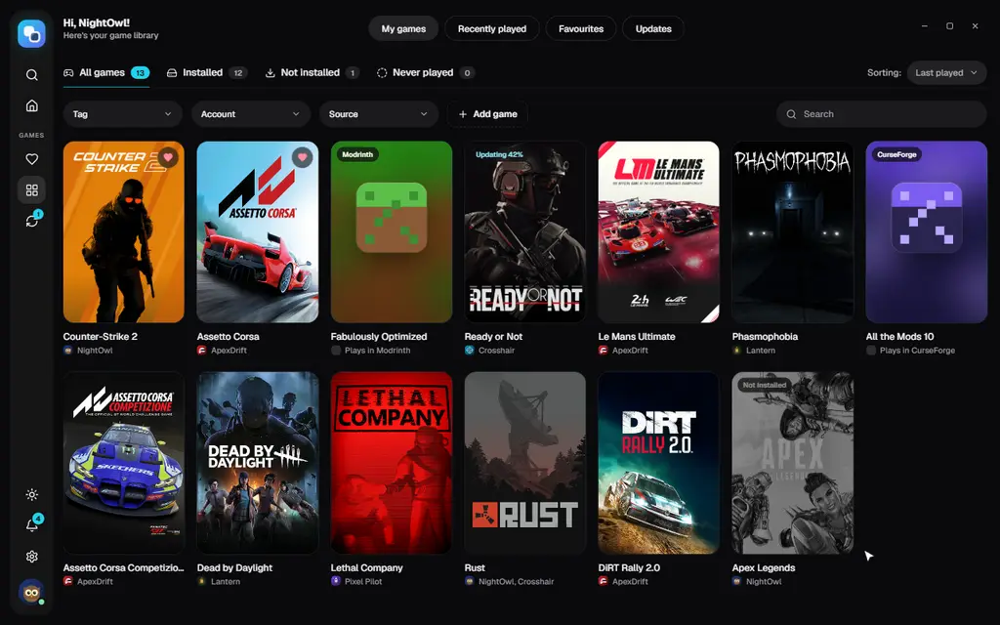
</picture>

<sub>The real app: covers, a game page, Minecraft modpacks, Play, and one click from dark to light</sub>

</div>

<table>
<tr>
<td width="45%" valign="middle">
<h3>🗂️ Your games up front</h3>
<ul>
<li>The <b>Library layout</b>: a rail on the left and every game as a <b>cover</b>, with tabs for installed, not installed and never played</li>
<li>Filter by <b>tag, account or source</b>, sort by last played, most played or name</li>
<li>Hover a cover for <b>Play</b>, details, a heart, and who it plays as, like <i>Switches to Crosshair</i></li>
<li><b>Right-click</b> any game: Play as another account once, tags, Change artwork, Open folder, Desktop shortcut and more</li>
<li><b>Ctrl + K</b> searches games, tags, accounts and actions</li>
<li>Prefer the old look? <b>Classic</b> is one click away in Settings → Appearance</li>
</ul>
</td>
<td width="55%">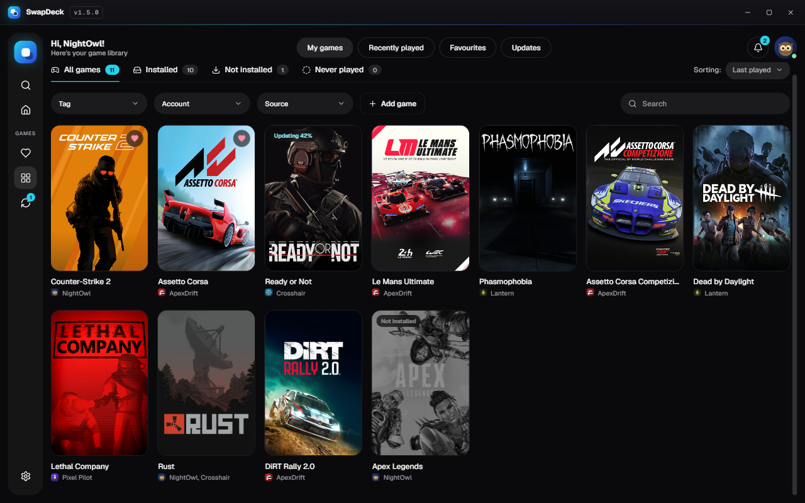</td>
</tr>
<tr>
<td width="55%">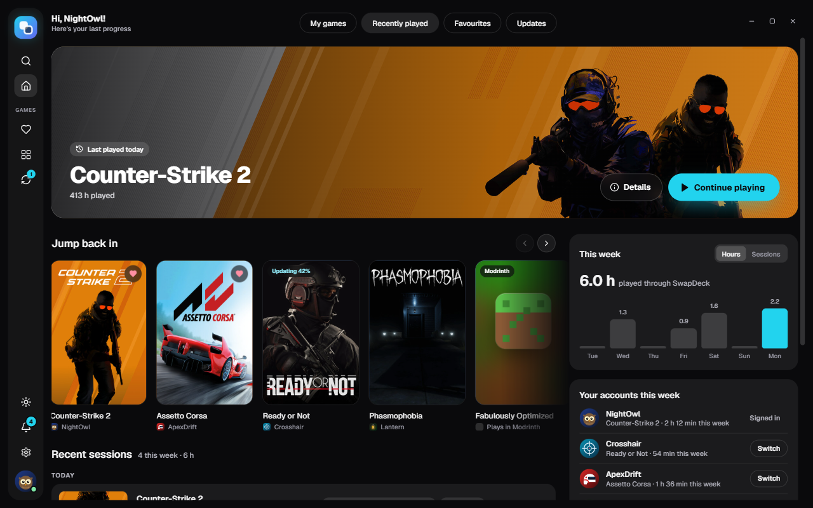</td>
<td width="45%" valign="middle">
<h3>🏠 Home, Favourites and Updates</h3>
<ul>
<li><b>Home</b>: your running or last game, <i>Jump back in</i>, recent sessions with the setup they used, this week's hours and your accounts</li>
<li><b>Latest achievements</b> across all your accounts, read from Steam's files on your PC</li>
<li><b>Favourites</b> as big cards in your own order. Adding one gives the heart a little burst</li>
<li><b>Updates</b>: what Steam is updating, what's waiting and what it updated lately. <i>Play when done</i> starts a game as soon as its update finishes</li>
</ul>
</td>
</tr>
<tr>
<td width="45%" valign="middle">
<h3>🎮 A full page for every game</h3>
<ul>
<li><b>Overview</b>: update status, last played, playtime, screenshots, DLC, workshop and friends who play it</li>
<li><b>Achievements</b>: how rare each one is, which of your accounts have it, with filters and sorting</li>
<li><b>Setup</b>: the game's monitor, resolution, sound, companion apps and launch options</li>
<li>On CS2's page: <b>Premier rating, ranks, level and medals</b> per account, and per-account CS2 configs</li>
<li>A <b>note</b> for each game: a crosshair code, a server IP…</li>
</ul>
</td>
<td width="55%">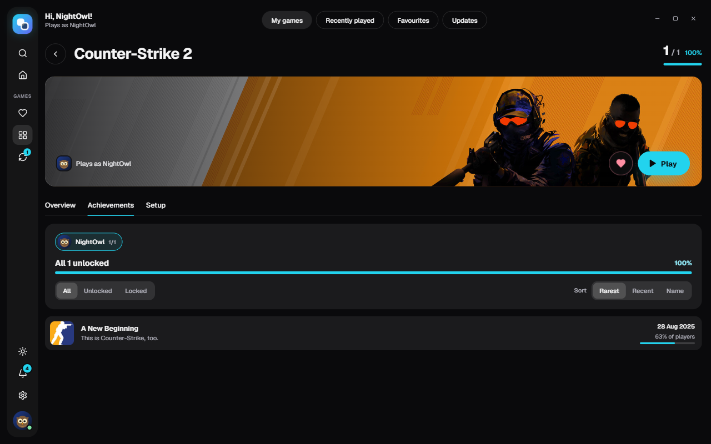</td>
</tr>
<tr>
<td width="55%">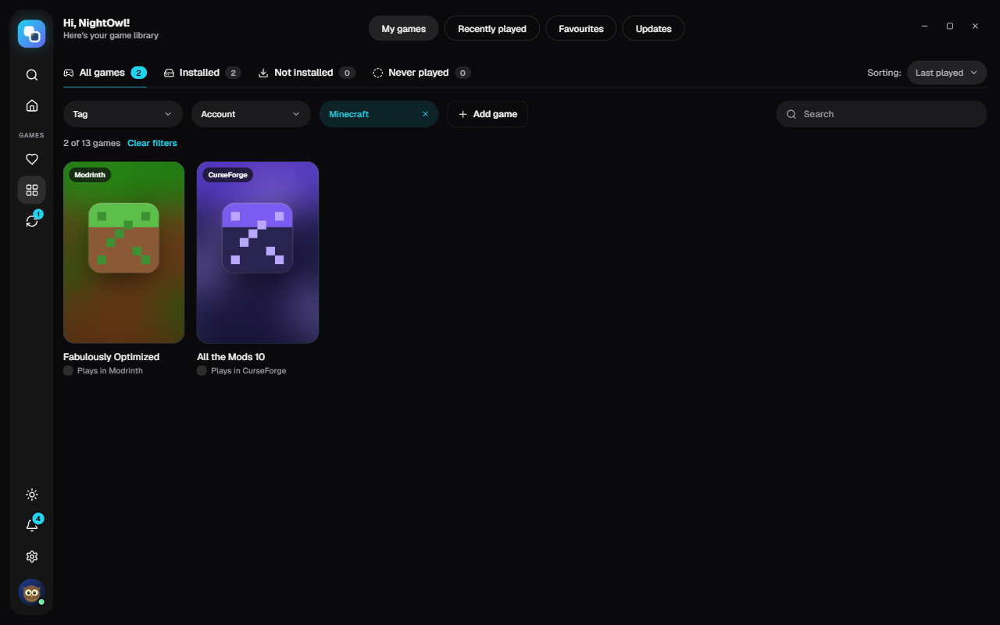</td>
<td width="45%" valign="middle">
<h3>⛏️ Minecraft modpacks</h3>
<ul>
<li>SwapDeck <b>finds your packs</b> from <b>Modrinth, CurseForge and Prism Launcher</b>, and you pick which ones join your Library</li>
<li><b>Play</b> opens the launcher straight into that pack, the same way its own desktop shortcut does</li>
<li>Each pack gets <b>its own setup</b>: monitor, resolution, sound and companion apps, like any game</li>
<li>SwapDeck notices when <b>Minecraft closes</b> and puts everything back</li>
<li>Covers take their colours from the <b>pack's icon</b>, or give it your own icon and banner</li>
</ul>
</td>
</tr>
<tr>
<td width="45%" valign="middle">
<h3>🎯 Play does the setup</h3>
<ul>
<li><b>Display</b>: make a monitor primary, or use only that one (even if it's off in Windows)</li>
<li><b>Resolution profiles</b> you make yourself, like 1280 × 960 stretched for CS2</li>
<li><b>Sound device</b> per game, e.g. your headset</li>
<li>Each step shows as it happens, with <i>Ready</i> for the ones already right, and your <b>note</b> with a <i>Copy</i> button</li>
<li><b>Cancel</b> while it starts, and everything is <b>put back</b> when the game exits</li>
<li>Stop can also <b>close the game</b> if you pick it, like Alt+F4, never forced</li>
</ul>
</td>
<td width="55%">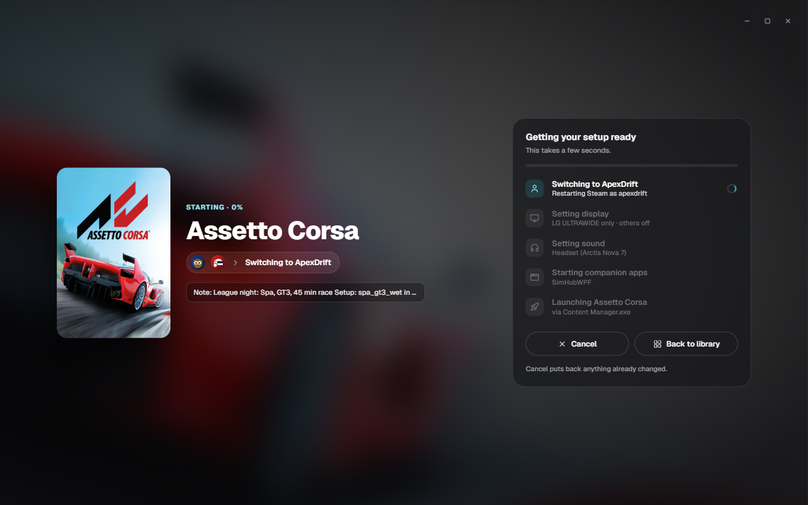</td>
</tr>
<tr>
<td width="55%">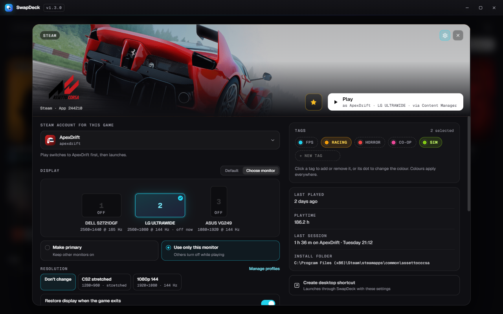</td>
<td width="45%" valign="middle">
<h3>🏁 Made for sim racing</h3>
<ul>
<li><b>Companion apps</b> start with the game: SimHub, Crew Chief, wheel software…</li>
<li>Tick <b>"Close when the game exits"</b> for the ones that should go with it</li>
<li>Start a <b>custom launcher</b> such as Content Manager, and keep the Steam art and tracking</li>
<li>Put the game on your <b>ultrawide only</b>, then get your normal desk back afterwards</li>
</ul>
</td>
</tr>
<tr>
<td width="45%" valign="middle">
<h3>👥 Accounts, sorted your way</h3>
<ul>
<li>One-click switching from the avatar menu, or the <b>"Who's playing?"</b> picker in Classic</li>
<li>A <b>full page</b> for each account: its most played games, recent sessions, wallet and member since</li>
<li><b>Tags, notes and favourites</b>, each tag with its own colour</li>
<li><b>Status at a glance</b>: online / in-game, VAC and trade bans, limited accounts</li>
<li><b>Hide account names</b> (initials only) for streaming</li>
</ul>
</td>
<td width="55%">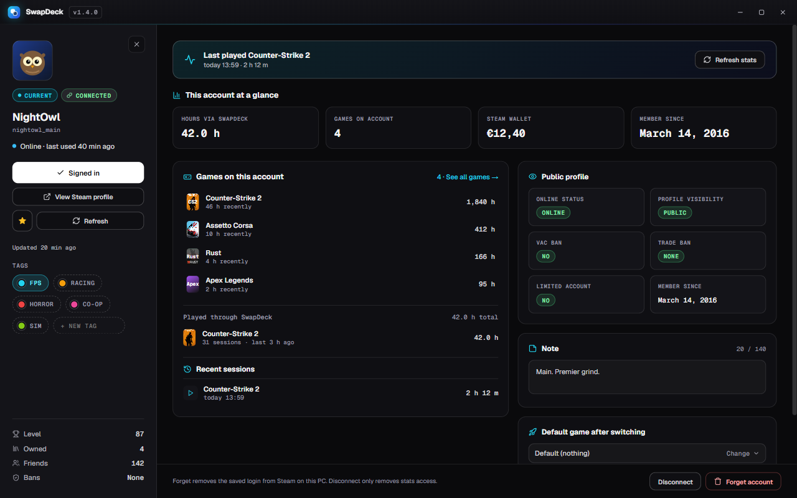</td>
</tr>
<tr>
<td width="55%">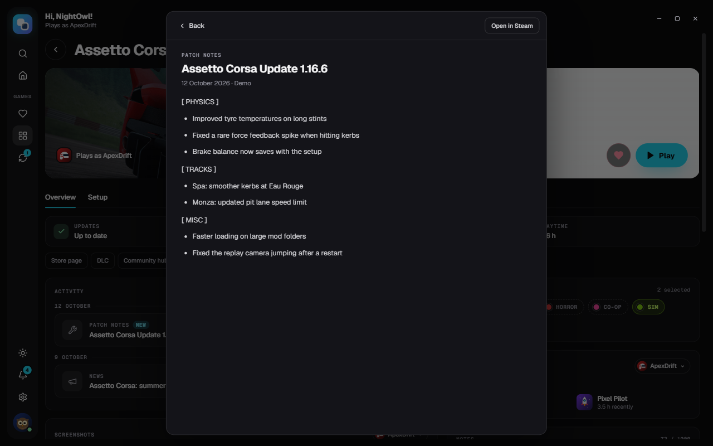</td>
<td width="45%" valign="middle">
<h3>📰 Patch notes, right in SwapDeck</h3>
<ul>
<li>The developer's <b>announcements and patch notes</b>, newest first</li>
<li><b>Read the whole post</b> in the app, with headings, lists and pictures</li>
<li>New patch notes for games you've played show under the <b>bell</b></li>
<li>Steam links open in Steam, trailers on YouTube, and <i>Open in Steam</i> is always there</li>
</ul>
</td>
</tr>
<tr>
<td width="45%" valign="middle">
<h3>🖥️ Your monitors, drawn to scale</h3>
<ul>
<li>Every monitor that's plugged in, <b>including ones switched off</b> in Windows</li>
<li>Pick the ones you use day to day and your main one</li>
<li>Windows' own layout is saved and restored, <b>rotation included</b></li>
<li><b>Restore display now</b> if a game ever crashes</li>
</ul>
</td>
<td width="55%">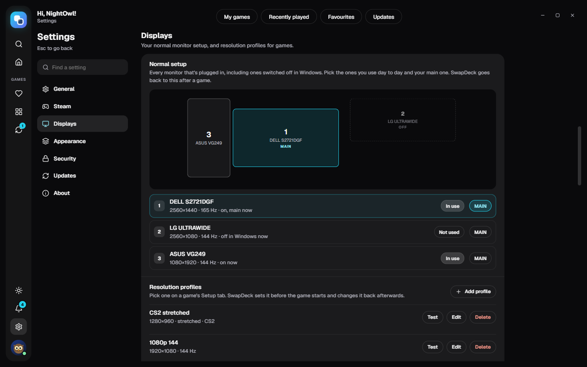</td>
</tr>
<tr>
<td width="55%">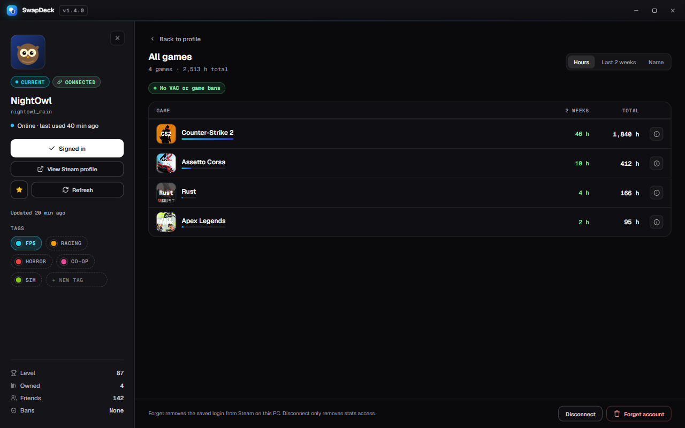</td>
<td width="45%" valign="middle">
<h3>📊 Stats, if you want them</h3>
<ul>
<li><b>Connect for stats</b> with Steam's own sign-in (QR code, password or token), or <b>Connect all</b> in one go</li>
<li><b>Every game the account owns</b> shows up, even ones not installed here, with total hours and VAC bans marked</li>
<li>CS2 <b>Premier rating</b>, Competitive and Wingman ranks, level and medals</li>
<li>Steam level, wallet balance, friends, and <b>friends who play</b> each game</li>
<li>Completely optional. Switching works without it</li>
</ul>
</td>
</tr>
<tr>
<td width="45%" valign="middle">
<h3>🎨 Make it yours</h3>
<ul>
<li><b>Light and dark</b> with one click on the sun or moon. The new colours pour in from the button, a little differently every time</li>
<li><b>Dark, OLED Black or Light</b>, with accent colours or your Windows accent, which can <b>follow the running game's tag</b></li>
<li><b>Animations</b> on pages, covers and tabs. <i>Reduce motion</i> turns them off</li>
<li><b>Auto UI scale</b> for 1080p, 1440p and 4K screens, or pick 80% to 150%</li>
</ul>
</td>
<td width="55%">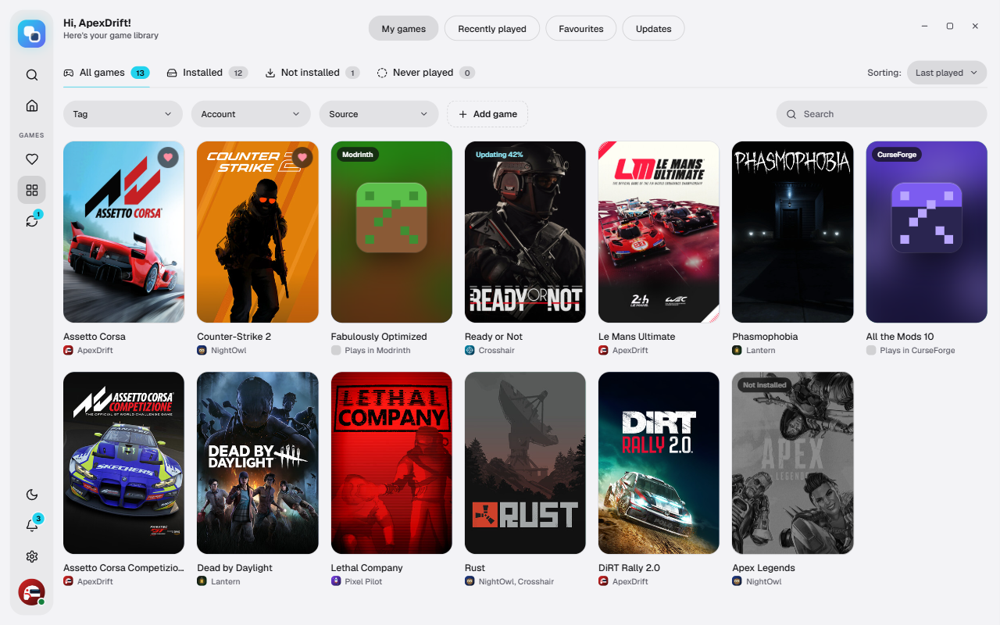</td>
</tr>
</table>

<sub>Screenshots use made-up demo accounts.</sub>

### And a lot more

<table>
  <tr>
    <td width="33%" valign="top">🧭 <b>Tray panel</b><br><sub>Switch accounts or start a game from the taskbar. A green dot shows while you play</sub></td>
    <td width="33%" valign="top">⌨️ <b>Tray shortcut</b><br><sub>Open the tray panel from any app with <code>Ctrl + Alt + S</code>. Off by default, key of your choice</sub></td>
    <td width="33%" valign="top">🎮 <b>Controller support</b><br><sub>D-pad, A / B / X / Y, and LB / RB to change pages or tabs</sub></td>
  </tr>
  <tr>
    <td width="33%" valign="top">🔔 <b>Notifications</b><br><sub>Updates, new patch notes, a running game and new modpacks under the bell</sub></td>
    <td width="33%" valign="top">✨ <b>Updates itself</b><br><sub>Within minutes of a release, with a Windows notification and a What's new</sub></td>
    <td width="33%" valign="top">🏷️ <b>Tags manager</b><br><sub>Rename, recolour and delete tags everywhere at once</sub></td>
  </tr>
  <tr>
    <td width="33%" valign="top">💾 <b>Backup & restore</b><br><sub>Tags, notes, games and profiles. Never sign-ins</sub></td>
    <td width="33%" valign="top">🔐 <b>Master password</b><br><sub>A lock screen on top of Windows' encryption, and <i>Lock now</i></sub></td>
    <td width="33%" valign="top">🚀 <b>Start with Windows</b><br><sub>Optionally straight to the tray</sub></td>
  </tr>
</table>

## Install

| File | |
|---|---|
| `SwapDeck-Setup-x.y.z.exe` | Installer (recommended). No admin needed, and it **updates itself**. |
| `SwapDeck-x.y.z-portable.exe` | Single file, no install. Doesn't auto-update. |

> [!NOTE]
> The app isn't code-signed yet, so Windows may show a SmartScreen warning the first time. Click **More info → Run anyway**.

A short first start finds Steam, lists your accounts and lets you pick the Library or Classic layout. You can skip it.

## Using it

| Action | How |
|---|---|
| Switch account | Library layout: your avatar at the bottom of the rail. Classic: click a card, or select it and press `Enter` |
| Play a game | Hover a cover → Play, or open the game and press Play |
| Game options | Right-click a cover, or `X` on a controller |
| A game's setup | Its page → Setup (Library layout), or the ⚙️ gear (Classic) |
| Search | `Ctrl + K` (Library layout), `/` (Classic) |
| Add Minecraft modpacks | The bell's *Review*, or Settings → General → *Choose packs* |
| Light or dark | The sun / moon in the rail (Library layout) or the top bar (Classic) |
| Tray panel from anywhere | `Ctrl + Alt + S` (turn it on in Settings → General) |
| Controller | `A` select · `B` back · `X` options · `Y` play · `LB`/`RB` pages · `☰` search |
| UI scale | `Ctrl +` / `Ctrl −` / `Ctrl 0` (auto), or Settings |

## Privacy

- Everything stays on your PC, in `%APPDATA%\SwapDeck`.
- **Connecting for stats is optional.** It uses Steam's own sign-in (QR code, password + Steam Guard, or a token you paste).
  SwapDeck keeps Steam's sign-in token, encrypted by Windows. Your password is stored only if you tick "Remember", also encrypted.
- Add a **master password** in Settings → Security for a lock screen on top of Windows' encryption.
- Disconnecting deletes the token. You can also revoke the "SwapDeck" device in your Steam account settings.
- Backups contain your tags, notes, games and profiles, never sign-ins or passwords.
- A game's page reads Steam's own files on your PC for update status, screenshots and achievements. Its news and
  DLC list come from Steam's public servers (no sign-in), only when you open that game, and are cached for a while.
- To know which accounts own a game, SwapDeck uses the game list of accounts connected for stats. For other accounts it
  reads Steam's own files on your PC, which list the games they've played here. Nothing is sent anywhere for this.
- For accounts connected for stats, a game's page also shows friends who play it and which DLC the account owns. That
  uses the account's saved Steam sign-in, only when you open the game, and talks only to Steam.
- How rare each achievement is, and the bell's new patch notes, come from Steam's public servers with no sign-in. Only the games' Steam app IDs are sent.
- Minecraft modpacks are read from Modrinth's, CurseForge's and Prism Launcher's own pack lists on your PC. To notice when Minecraft
  runs, SwapDeck looks at the Java programs running on your PC. Nothing is sent anywhere.
- SwapDeck checks GitHub for a new version every 30 minutes and when you open it. Each check downloads one small file; nothing about you is sent.
- *Close the game too* (when you press Stop) asks the game's windows on your PC to close, like Alt+F4. It never forces a game closed.

## FAQ

<details>
<summary><b>Can SwapDeck get me VAC banned?</b></summary>

No. SwapDeck never touches a running game: it doesn't inject anything, read game memory or change game files while you play.
Switching only changes which saved login Steam starts with, the same as picking an account in Steam yourself.
The only game files it ever writes are CS2 config files, and only when you ask: your per-account autoexec, or copying settings from one account to another.

</details>

<details>
<summary><b>Does it close my game when I press Stop?</b></summary>

Not unless you ask. Stop puts your display and sound back and stops tracking playtime, and the game keeps running.
If you pick <i>Close the game too</i>, SwapDeck asks the game's windows to close, like Alt+F4. It never forces it.

</details>

<details>
<summary><b>Library or Classic layout?</b></summary>

Either. <b>Library</b> puts your games up front as covers, with Home, Favourites, Updates and full game pages.
<b>Classic</b> puts your accounts up front, like SwapDeck always has. Switch any time in Settings → Appearance; nothing is lost.

</details>

<details>
<summary><b>My CurseForge modpack doesn't start</b></summary>

CurseForge only starts packs from outside the app when it's set to <b>Use CurseForge launcher</b>. In CurseForge, open
Settings → Minecraft and pick it, then press Play in SwapDeck again. With the Mojang launcher, CurseForge says
<i>Cannot launch modpack with Mojang launcher</i>. Modrinth and Prism Launcher don't need anything.

</details>

<details>
<summary><b>Where are my logins kept?</b></summary>

Steam keeps them, like it always does. SwapDeck only tells Steam which saved account to start with.
If you connect an account for stats, Steam's sign-in token is stored encrypted by Windows. See [Privacy](#privacy).

</details>

<details>
<summary><b>How do updates work?</b></summary>

The installed version checks GitHub every 30 minutes and when you open it, downloads a new version in the background, and
tells you when it's ready (in the app, or with a Windows notification if SwapDeck is in the tray). Restart to finish.
The portable exe doesn't update itself.

</details>

<details>
<summary><b>Why does Windows warn me when I run the installer?</b></summary>

The app isn't code-signed yet, so SmartScreen doesn't recognise it. Click <b>More info → Run anyway</b>. The full source is right here.

</details>

<details>
<summary><b>My screens are wrong after a game crashed. How do I fix them?</b></summary>

Open Settings → Displays → <b>Restore display now</b>. If you can't see SwapDeck, press <code>Win + P</code> → Extend first.

</details>

## Good to know

- Steam's **"Ask which account to use each time Steam starts"** blocks automatic sign-in, so SwapDeck turns it off when you switch.
- If Steam asks for a password after a switch, that account's saved login expired. Sign in once with **Remember me** ticked.
- CS2 stats aren't refreshed while that account is in a game, because it would kick the game session.
- SwapDeck only knows **every game an account owns** once it's connected for stats. Until then, it goes by what that account has played on this PC.
- **Monitors** only need to be plugged in and powered. SwapDeck can switch one on that's turned off in Windows.
- **Resolution profiles** can only use sizes your graphics driver offers. For stretched 4:3, add the resolution as a custom
  resolution in AMD Software or the NVIDIA Control Panel, and set scaling to Full panel / Full-screen. The **Test** button
  in Settings → Displays tells you if Windows accepts it.
- ATLauncher and MultiMC modpacks aren't found yet. Add them with *Add game* and the launcher's own launch options.

## Bugs and ideas

- Found a bug or have an idea? [Open an issue](https://github.com/byteminite/SwapDeck/issues/new/choose). The forms ask for the few details that help.
- Questions and chat go in [Discussions](https://github.com/byteminite/SwapDeck/discussions).
- A security problem? Please report it privately, see [SECURITY.md](SECURITY.md).
- Every version's changes are in [CHANGELOG.md](CHANGELOG.md), and in the app under *What's new*.

## Development

```bash
npm install
npm run dev     # run from source with its own test profile (your real settings stay untouched)
npm start       # run from source with your normal settings
npm run dist    # build installer + portable exe into dist\
```

**Releasing an update:** bump `version` in `package.json`, add the release to `src/renderer/changelog.js`, run
`node tools/changelog-md.js` to refresh CHANGELOG.md, run `npm run dist`, then publish a GitHub release (tag `vX.Y.Z`)
with `SwapDeck-Setup-X.Y.Z.exe`, its `.blockmap` and `latest.yml`. Installed copies pick it up automatically. Drafts are ignored.

## How it's made

SwapDeck is vibe coded: it was designed, directed and tested by me ([@byteminite](https://github.com/byteminite)), and the code was
written by **Claude**, Anthropic's AI, using [Claude Code](https://claude.com/claude-code) running in
[Munder Difflin](https://munderdiffl.in/), a free, open source multi-agent harness, and [PandaOS](https://pandaos.ai/). That includes the app, the native display
and sound helpers, the browser demo, this README and its animated demo. Every feature was tried on a real setup (multiple
accounts, three monitors, sim racing gear, Minecraft modpacks) before it shipped, and the full source is here for anyone to read.

## License

[MIT](LICENSE)
